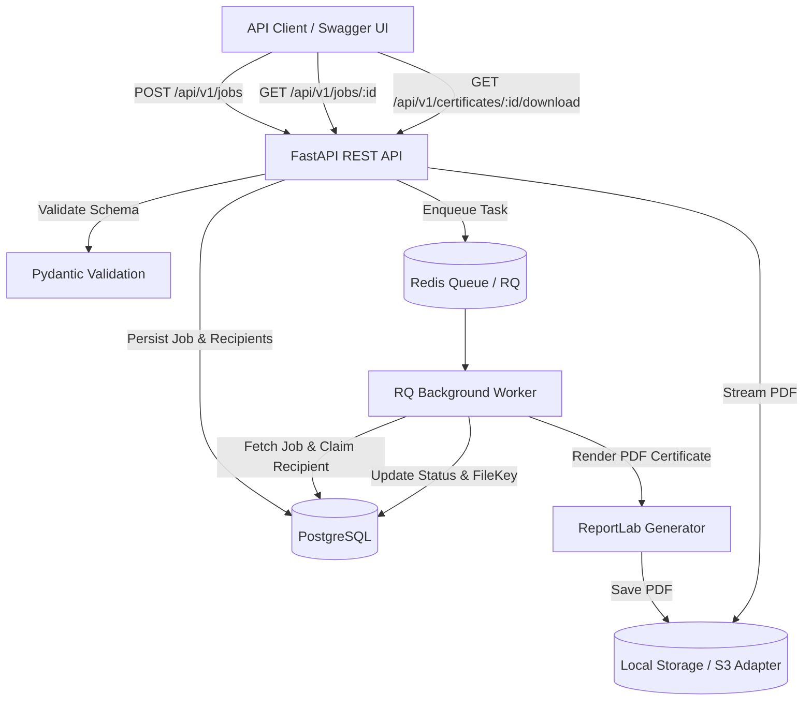

# Certix — Architecture and Design Specification

> This document captures the architecture, component boundaries, database design, API design, and background processing strategy for Certix.

For the detailed architecture reference, see [docs/project_architecture.md](file:///d:/Projects/1-active/Certix/docs/project_architecture.md).

## 1. System Overview
Certix is a high-performance, resilient Bulk Certificate Generator backend API built with FastAPI, SQLAlchemy 2.x, PostgreSQL, Redis + RQ, and ReportLab.

## 2. Core Decisions Matrix

| Decision Area | Chosen Approach | Rationale |
|---|---|---|
| **Python Version** | Python 3.12+ | Modern type hinting, performance optimizations, active LTS. |
| **Framework** | FastAPI | High throughput, asynchronous endpoint support, automatic OpenAPI docs. |
| **Persistence** | PostgreSQL + SQLAlchemy 2.x + Alembic | Transactional integrity, UUID primary keys, migration safety. |
| **Background Processing** | Redis + RQ | Decouples PDF rendering from HTTP request cycle; provides job queueing. |
| **PDF Generation** | ReportLab | Production-tested PDF engine capable of precise layout, Unicode, and styling. |
| **Failure Isolation** | Per-recipient try/catch & status tracking | Failure on recipient $N$ never prevents recipient $N+1$ from rendering. |
| **Status Semantics** | `queued` → `processing` → `completed` / `completed_with_errors` / `failed` | Clear, deterministic state machine agreed with API contract. |
| **File Storage** | Safe relative key `certificates/{certificate_id}.pdf` | Strict root-path boundary prevents path traversal; server controls filenames. |
