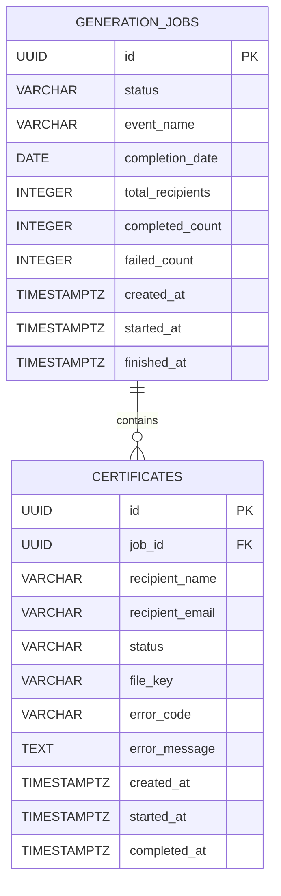

# Certix Database Design

**Project:** Certix — Bulk Certificate Generator  
**Database:** PostgreSQL  
**ORM:** SQLAlchemy 2.x  
**Migrations:** Alembic  
**Status:** Proposed initial schema

This document defines the initial relational model for Certix. It is aligned with the project specification and API contract. The SQLAlchemy models, migrations, tests, and API contract must remain consistent with this design.

---

## 1. Design Principles

- PostgreSQL is the source of truth for job and recipient status.
- One generation job has many recipient-result records.
- Every submitted recipient entry should have a result, including invalid entries that can be represented safely.
- Store generated files on disk for the MVP; store a relative storage key in the database, not arbitrary client-provided paths.
- Use UUIDs for externally visible identifiers.
- Use timezone-aware timestamps stored consistently in UTC.
- Keep database transactions short; do not hold a transaction open while generating PDFs.
- Use foreign keys, check constraints, and indexes to preserve data integrity.
- Do not store PDF bytes in PostgreSQL for the initial version.

## 2. Entity Relationship Diagram



**Relationship:** one `generation_jobs` row may have zero or more `certificates` rows. Each certificate/result row belongs to exactly one job.

## 3. Table: `generation_jobs`

Stores one row for each accepted bulk request.

| Column | PostgreSQL type | Nullable | Description |
|---|---|---:|---|
| `id` | `UUID` | No | Primary key, generated by the server |
| `status` | `VARCHAR(32)` | No | Job lifecycle status |
| `event_name` | `VARCHAR(200)` | No | Shared event/course name used on certificates |
| `completion_date` | `DATE` | No | Shared completion date |
| `total_recipients` | `INTEGER` | No | Number of submitted recipient entries |
| `completed_count` | `INTEGER` | No | Number of successfully generated certificates |
| `failed_count` | `INTEGER` | No | Number of failed recipient entries |
| `created_at` | `TIMESTAMPTZ` | No | Creation timestamp |
| `started_at` | `TIMESTAMPTZ` | Yes | First processing timestamp |
| `finished_at` | `TIMESTAMPTZ` | Yes | Terminal-state timestamp |

### Constraints

- Primary key on `id`.
- `total_recipients >= 1`.
- `completed_count >= 0`.
- `failed_count >= 0`.
- `completed_count + failed_count <= total_recipients`.
- `status` must be one of:
  - `queued`
  - `processing`
  - `completed`
  - `completed_with_errors`
  - `failed`

The empty recipient list is rejected by the API, so accepted jobs have at least one recipient.

## 4. Table: `certificates`

Stores one result for each recipient entry in a job. The name `certificates` is retained for compatibility with the API contract, although a row also represents an invalid or failed recipient entry that did not produce a PDF.

| Column | PostgreSQL type | Nullable | Description |
|---|---|---:|---|
| `id` | `UUID` | No | Primary key and externally visible certificate/result ID |
| `job_id` | `UUID` | No | Foreign key to `generation_jobs.id` |
| `recipient_name` | `VARCHAR(200)` | Yes | Validated recipient name, if available |
| `recipient_email` | `VARCHAR(320)` | Yes | Recipient email, if available |
| `status` | `VARCHAR(32)` | No | Recipient processing status |
| `file_key` | `VARCHAR(500)` | Yes | Relative storage key for a generated PDF |
| `error_code` | `VARCHAR(64)` | Yes | Machine-readable failure category |
| `error_message` | `TEXT` | Yes | Safe, useful explanation of the failure |
| `created_at` | `TIMESTAMPTZ` | No | Result-record creation timestamp |
| `started_at` | `TIMESTAMPTZ` | Yes | Processing start time |
| `completed_at` | `TIMESTAMPTZ` | Yes | Time processing reached a terminal state |

### Constraints

- Primary key on `id`.
- Foreign key `job_id` references `generation_jobs.id`.
- `ON DELETE CASCADE` is appropriate for the initial application if deleting a job is ever supported; otherwise, expose no deletion endpoint and retain records.
- `status` must be one of:
  - `pending`
  - `processing`
  - `completed`
  - `failed`
- A completed record must have a non-null `file_key`.
- A non-completed record must not be offered as downloadable.
- Invalid recipient data may result in null name/email fields, but the record must still retain its job relationship and a useful error code/message.
- The application must ensure that `file_key` is relative and cannot escape the configured storage root.

## 5. Relationships and Indexes

### Foreign key

`certificates.job_id` references `generation_jobs.id`.

### Recommended indexes

| Index | Reason |
|---|---|
| Primary key on `generation_jobs.id` | Look up a job by ID |
| Primary key on `certificates.id` | Look up a certificate/result by ID |
| Index on `certificates.job_id` | List all results for a job efficiently |
| Composite index on `certificates(job_id, status)` | Count and filter results by job/status |
| Index on `generation_jobs(status, created_at)` | Find queued or stale jobs for worker recovery |
| Optional index on `certificates.created_at` | Operational inspection and retention jobs |

Do not add a uniqueness constraint on recipient email within a job by default. Duplicate recipient entries should remain separately traceable unless product requirements explicitly call for deduplication.

## 6. Status and Counter Semantics

### Recipient status transitions

```text
pending -> processing -> completed
                     \-> failed
```

Invalid recipient entries may transition directly from initial record creation to `failed`.

### Job status transitions

```text
queued -> processing -> completed
                     -> completed_with_errors
                     -> failed
```

Use these final-state semantics:

- `completed`: all recipient records are `completed`.
- `completed_with_errors`: at least one recipient is `completed` and at least one is `failed`.
- `failed`: the job itself could not be run as a whole, or every recipient failed according to the policy selected by the application.
- `queued` and `processing` are non-terminal states.

### Counters

- `total_recipients`: number of recipient entries submitted.
- `completed_count`: number of certificate records with status `completed`.
- `failed_count`: number of certificate records with status `failed`.
- `processed_count` is not stored initially; calculate it as `completed_count + failed_count`.
- Progress percentage is `processed_count / total_recipients * 100`.

Because counters duplicate information present in child rows, every counter update must be made consistently with the recipient status update. For a small assignment, counters can be computed from child rows on reads instead; this reduces drift risk. If persisted counters are retained for fast reads, update them transactionally and test their consistency.

## 7. Transaction Boundaries

### Creating a job

Within one database transaction:

1. Insert the `generation_jobs` row with status `queued`.
2. Insert one `certificates` row for each submitted recipient.
3. Commit.

Queue submission should occur after the transaction commits. Since a process can fail between commit and enqueue, the implementation must handle dispatch failure, for example by recording a dispatch error or periodically recovering queued jobs that were never enqueued.

### Processing one recipient

For each recipient:

1. Claim the recipient for processing and persist the `processing` status.
2. Generate the PDF outside a long-running database transaction.
3. Save the file to a temporary path, then atomically move it into its final storage location.
4. Persist `file_key`, `completed` status, and completion timestamp in a short transaction.
5. If processing fails, persist `failed` status and a safe error code/message, then continue to the next recipient.

If the database update fails after a PDF is written, a retry or reconciliation process should be able to detect and clean up orphaned files or safely reuse the expected storage key.

### Finalizing a job

After all recipient records are terminal:

1. Read the recipient outcomes.
2. Reconcile counts.
3. Set the final job status according to the documented policy.
4. Set `finished_at`.

## 8. Concurrency and Idempotency

- Avoid allowing two workers to generate the same recipient simultaneously.
- Claim work using a guarded status update or row-level locking.
- Make file keys deterministic per certificate ID, for example `certificates/<certificate_id>.pdf`, while ensuring retries are safe.
- Do not rely on Redis alone to prevent duplicate processing.
- Consider a unique job dispatch identifier if retries may enqueue the same job more than once.
- Ensure only one terminal outcome is recorded for a recipient.
- Add explicit idempotency keys for client submissions only if required; they are not part of the initial API contract.

## 9. File Storage

For the MVP, store PDF files on the local filesystem outside source-controlled code. Store a relative `file_key` in PostgreSQL.

Example storage layout:

```text
storage/
└── generated/
    └── certificates/
        ├── <certificate-uuid-1>.pdf
        └── <certificate-uuid-2>.pdf
```

Rules:

- Resolve file keys under a configured storage root.
- Reject path traversal and absolute paths.
- Do not accept file paths from API clients.
- Do not return server filesystem paths in API responses.
- Only allow downloads for completed records with an existing file.
- Use a shared volume when API and worker run in separate containers.
- A future object-storage implementation should preserve the same storage-service interface.

## 10. SQLAlchemy Model Guidance

- Use SQLAlchemy 2.x declarative mappings.
- Use Python `uuid.UUID` with PostgreSQL UUID columns.
- Use `datetime` values with timezone awareness for `TIMESTAMPTZ`.
- Represent `completion_date` as a Python `date`.
- Use Python enums or constrained strings for statuses; ensure database constraints match application enums.
- Define a relationship from `GenerationJob` to its `Certificate` records.
- Keep database session lifetimes short and do not pass an active session into long-running PDF generation work.
- Use Alembic migrations for schema changes rather than relying on `create_all()` in production paths.

## 11. Deletion and Retention Policy

The initial API does not include job or certificate deletion. Retain job/result metadata and generated files for the duration needed by the assignment demonstration.

If deletion or retention cleanup is added later:

- Define whether deleting a job deletes its recipient records.
- Delete or expire stored PDFs consistently with database records.
- Avoid deleting files while a download or worker operation is active.
- Document retention duration and cleanup behavior.

## 12. Database Test Requirements

Test at least:

- Creating a job and its recipient records.
- Foreign-key enforcement.
- Status and count constraints.
- Persisting a failed recipient alongside successful recipients.
- Progress and final-state calculations.
- Concurrent worker claims or duplicate-task protection.
- Transaction rollback when job creation fails.
- Handling database errors during result persistence.
- Ensuring counters agree with child records.
- Migrations on a fresh database.

## 13. Open Decisions to Finalize Before Implementation

1. **Counter strategy:** compute counts from recipient rows, or persist and update counters transactionally. Recommended initial approach: compute from rows until performance requires stored counters.
2. **All-failed jobs:** use `failed` or `completed_with_errors` when all recipient entries fail. Choose one policy and apply it consistently in the API contract and tests.
3. **Invalid recipient persistence:** retain invalid entries as failed rows. This requires validating individual entries without rejecting the whole batch for every recipient-level error.
4. **Queue recovery:** decide how to detect and re-enqueue jobs committed to PostgreSQL but not submitted to Redis.
5. **File cleanup:** decide how to clean up orphaned PDFs after interrupted generation or database failures.

## 14. Definition of Done

The database design is implemented when:

- The tables and foreign keys match this document.
- Alembic can create the schema on a fresh database.
- Job and recipient states are persisted.
- Invalid and failed recipients remain traceable.
- Counts and final status are consistent with recipient rows.
- Generated file keys are safe and downloads resolve only within the configured storage root.
- Database constraints and transactional behavior are covered by automated tests.
